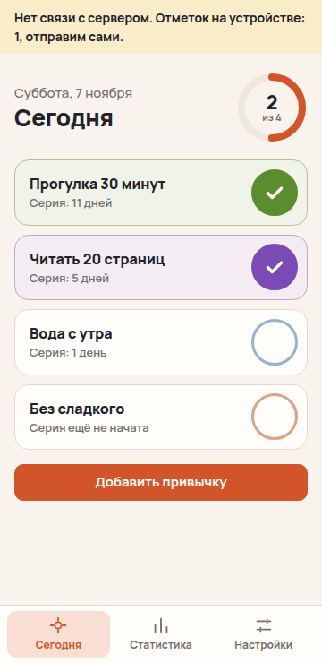
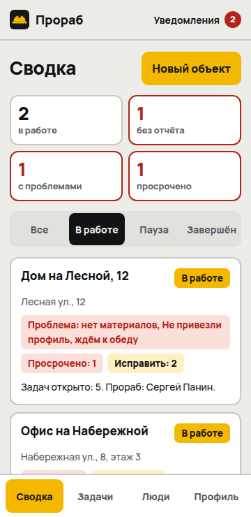

# Трекеры

Пять трекеров по реальным заказам с фриланс-бирж. Учебные кейсы для портфолио [myfreelab.ru](https://myfreelab.ru): заказчикам ничего не отправлялось, все данные в демо выдуманные.

У трекеров одна основа `core/`: сервер, вход, роли, сессии и защита. Экраны и логика у каждого свои. Сторонних пакетов нет, нужен только Node 22 со встроенной SQLite.

| № | Трекер | Для кого | Статус |
|---|---|---|---|
| 1 | [Пульс задач](https://pulse.myfreelab.ru) | Команда: задачи, доска, Telegram-бот | готов |
| 2 | [Серия](https://seriya.myfreelab.ru) | Привычки: PWA, работает без сети, push-напоминания | готов |
| 3 | [Прораб](https://prorab.myfreelab.ru) | Стройка: объекты, ежедневные отчёты, фото, контроль качества | готов |
| 4 | Здоровье | Показатели, врач, тренер, нутрициолог | в работе |
| 5 | Репетитор | Задания, статистика, расписание | в работе |

## Пульс задач

Задачи ставятся в Telegram, а общая картина видна в веб-приложении.


- Роли: администратор, руководитель, сотрудник. Права проверяет сервер, а не интерфейс.
- Статусы: Новая → В работе → На проверке → Готово. Задачу принимает руководитель.
- Канбан-доска с перетаскиванием мышью и пальцем, история изменений, комментарии.
- Бот: задача из чата одной строкой, кнопки, напоминания о сроках, утренняя сводка.
- Веб-приложение внутри Telegram: вход без пароля, цвета темы Telegram.
- Бот не имеет своих прав: он работает через тот же API от имени человека.

ТЗ: [docs/01_zadachi_TZ.md](docs/01_zadachi_TZ.md).

### Запуск

```bash
# Демо с выдуманной командой
DEMO=1 node --disable-warning=ExperimentalWarning cases/01_zadachi/app/server.js

# Рабочий режим
ADMIN_LOGIN=admin ADMIN_PASSWORD=придумайте node --disable-warning=ExperimentalWarning cases/01_zadachi/app/server.js
```

Адрес: http://127.0.0.1:8801. Для бота задайте `BOT_TOKEN` и `PUBLIC_URL`.

## Серия

Личный трекер привычек. Ставится на телефон из браузера и работает без интернета.



- Отметка одним нажатием, серия дней подряд, лучшая серия, процент за 30 дней, календарь.
- Без сети приложение открывается и считает всё на устройстве, отметки уходят на сервер при появлении связи.
- При споре двух устройств побеждает более позднее изменение.
- Push-напоминания без сторонних пакетов: шифрование RFC 8291 и подпись VAPID в `core/webpush.js`.
- В демо у каждого посетителя своя песочница, она удаляется через 7 дней.

ТЗ: [docs/02_privychki_TZ.md](docs/02_privychki_TZ.md).

```bash
SANDBOX=1 node --disable-warning=ExperimentalWarning cases/02_privychki/app/server.js
```

Адрес: http://127.0.0.1:8802.

## Прораб

Внутренний инструмент стройкомпании: что происходит на каждом объекте, с телефона и без лишних кнопок.



- Четыре роли, у каждой свой главный экран: директор, менеджер проектов, прораб, рабочий.
- Ежедневный отчёт заполняется меньше чем за минуту, править можно только в тот же день.
- Сводка показывает объекты без отчёта и с проблемами.
- Фото уменьшаются в браузере перед отправкой, сервер проверяет содержимое файла, без входа фото не открываются.
- Контроль качества по спискам работ, из дефекта одной кнопкой создаётся задача.

ТЗ: [docs/03_stroyka_TZ.md](docs/03_stroyka_TZ.md). Снимки в демо сгенерированы нейросетью.

```bash
DEMO=1 node --disable-warning=ExperimentalWarning cases/03_stroyka/app/server.js
```

Адрес: http://127.0.0.1:8803.

## Проверки

```bash
node --disable-warning=ExperimentalWarning --test tests/*.test.js
```

Тесты ходят в настоящий сервер по HTTP, от лица каждой роли и в обход интерфейса. Telegram в них подменён.
